<meta name="robots" content="noindex, nofollow">

All core competencies can be assigned into one of four categories: [ **Values**]{.cc-value}, [ **Skills**]{.cc-skill}, [ **Stewardship**<]{.cc-steward}, and [ **Results**]{.cc-result}. Click a competency below to see a short description and growth indicators. Clicking one of the card images will zoom it in and make the image more easily visible.

## [ Values | Valores]{.cc-value}

:::{.callout-note icon="false" collapse="true"}
###  Exercise creative courage \| Ejercitar la valentía creativa

**Act with curiosity and bravery, share bold ideas, and embrace both experimentation and the inevitable mistakes that come with trying something new.**

>  Is passionate about possibility and recognizes paths for emergence of new ideas and processes    Sets clear, but kind boundaries    Invites sharing and celebration of wild ideas along with the mistakes that will come when trying them

:::

:::{.callout-note icon="false" collapse="true"}
###  Take action to learn \| Tomar acción para aprender

**Pursue learning through deliberate action, balance reflection with progress, and work steadily toward long-term goals despite challenges.**

>  Designs a personal learning pathway; co-creates opportunities for learning    Balances quick action with thoughtful reflection

:::

:::{.callout-note icon="false" collapse="true"}
###  Empathize \| Empatizar

**Listen deeply to others' experiences, and create opportunities that center the voices of the people and communities you are working with.**

>  Actively seeks insight from the experience and perspective of others    Connects with people from a place of love, respect and curiosity

:::

:::{.callout-note icon="false" collapse="true"}
###  Embrace vulnerability \| Abrazar la vulnerabilidad

**Step into uncertainty with openness, ask for support and feedback, and own your learning and growth with honesty and courage.**

>  Seeks help, feedback and collaboration    Owns where they are and what they need to learn

:::

:::{.callout-note icon="false" collapse="true"}
###  Work with adaptability \| Trabajar con adaptabilidad

**Embrace change, pivot with intention, and stay open to evolving paths and outcomes.**

>  Shows an ability and willingness to pivot and course correct, and stay open to what the process and results look like

:::

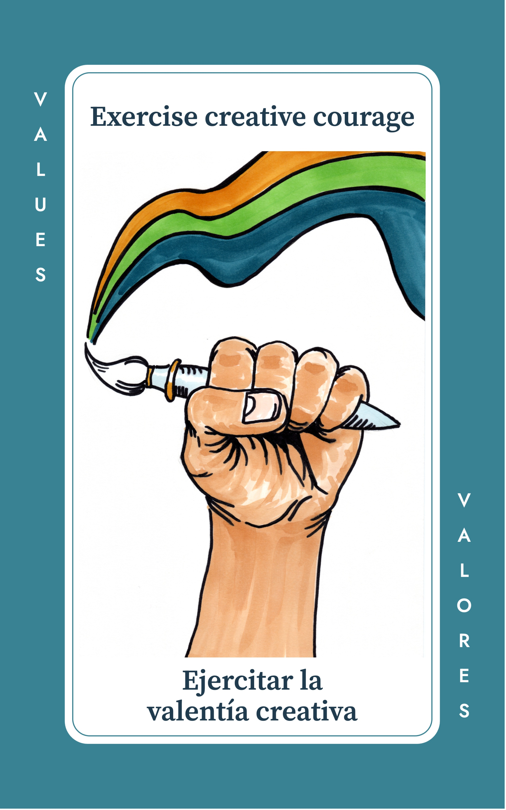{alt="Illustrated hand grabbing a paint brush from which a simple rainbow emanates" style="float: left; margin-left: 15px; margin-top: 10px; margin-bottom: 20px;" width="18%" .lightbox}
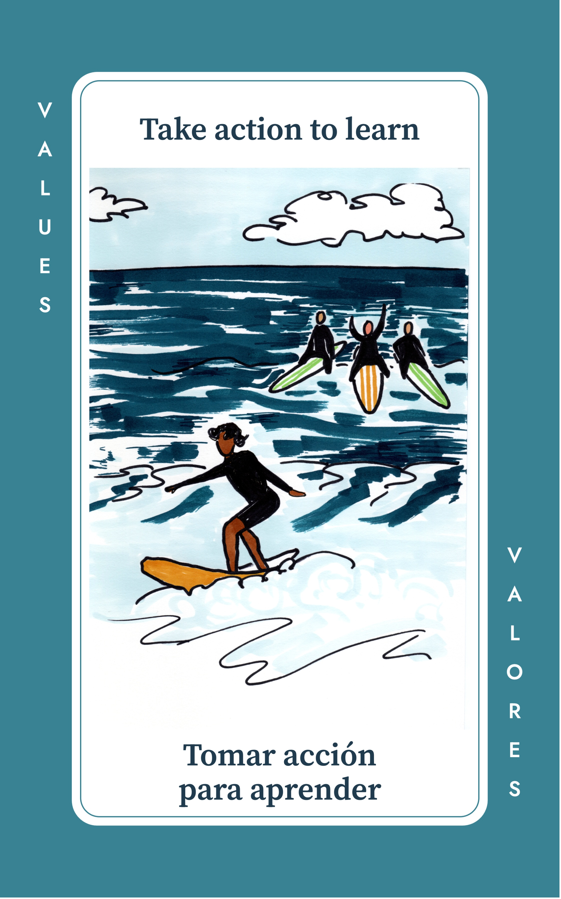{alt="Illustrated surfer catches a wave while other surfers look on and cheer" style="float: left; margin-left: 15px; margin-top: 10px; margin-bottom: 20px;" width="18%" .lightbox}
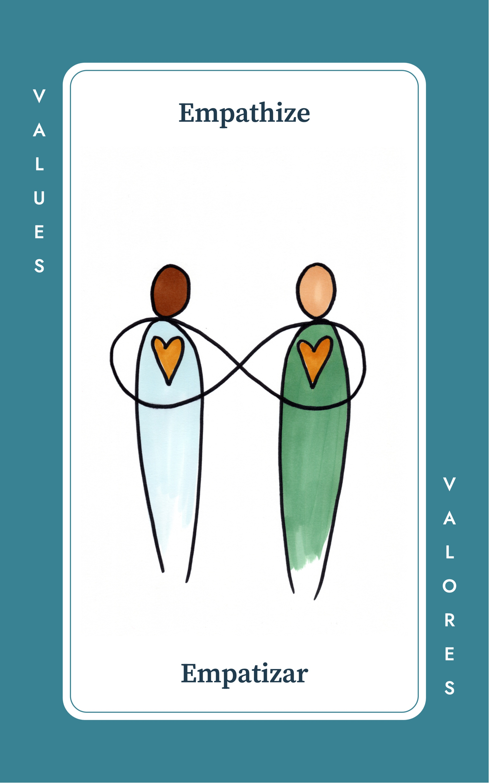{alt="Two illustrated people with stylized hearts make an infinity symbol with their arms" style="float: left; margin-left: 15px; margin-top: 10px; margin-bottom: 20px;" width="18%" .lightbox}
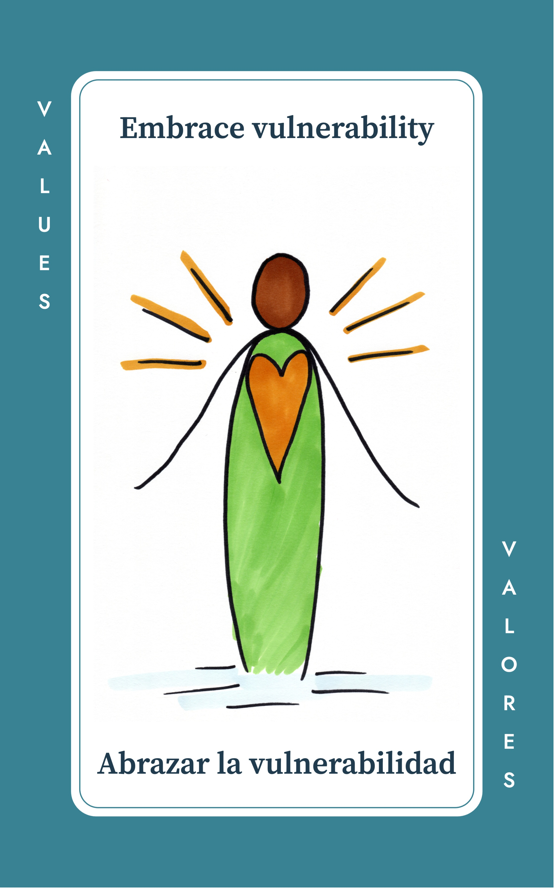{alt="Illustrated person with a large, stylized heart with radiating lines surrounding them" style="float: left; margin-left: 15px; margin-top: 10px; margin-bottom: 20px;" width="18%" .lightbox}
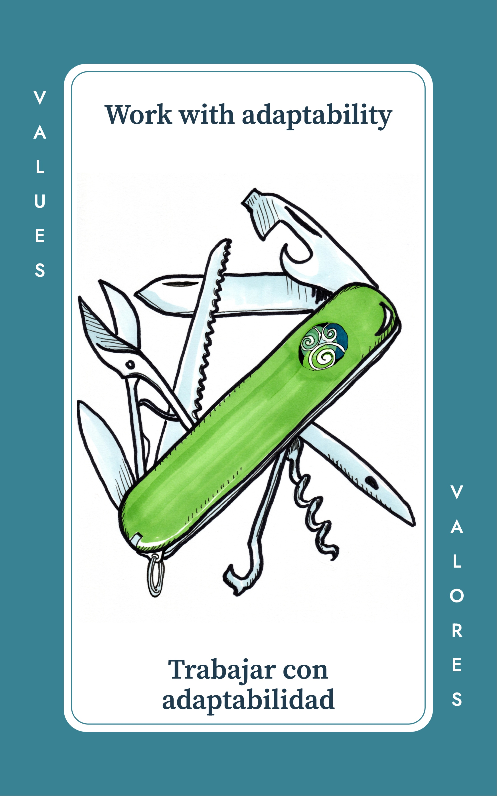{alt="Illustrated Swiss army knife" style="float: left; margin-left: 15px; margin-top: 10px; margin-bottom: 20px;" width="18%" .lightbox}

## [ Skills | Habilidades]{.cc-skill}

:::{.callout-warning icon="false" collapse="true"}
###  Bring vision to life \| Dar vida a la visión

**Passionately co-creates an inspiring vision, translate it into clear agreements and goals, and follow through with disciplined prioritization and daily execution.**

>  Passionately co-creates an inspiring vision, shares the big picture, and follows through to execution of vision    Creates clear team agreements, goals, expectations, and co-constructed narratives    Takes ownership across all levels of work in realizing the vision, demonstrating the ability to strategize, prioritize, organize, and manage tasks and key milestones

:::

:::{.callout-warning icon="false" collapse="true"}
###  Candid communication \| Comunicación sincera

**Speak and write openly, honestly, and with compassion, keeping messages clear, timely, and accessible.**

>  Adapts language, tone, and style to different audiences and contexts to connect effectively across differences    Communicates with authentic candor and compassion, sharing truth while owning their impact on others    Shares information consistently and in a timely manner to maintain alignment, and when out of alignment to name it and address it in real time    Models excellent writing skills and professional email correspondence   Expresses ideas clearly and concisely, making complex concepts accessible

:::

:::{.callout-warning icon="false" collapse="true"}
###  Distributed leadership \| Liderazgo distribuido

**Step up to lead where opportunities arise and create space for others to lead, share power, and break down top-down structures through collaboration.**

>  Actively creates space for others to lead and contribute, recognizing diverse strengths    Identifies need and steps into leadership, taking initiative to move work forward    Shares decision-making to distribute authority and fosters shared ownership    Delegates thoughtfully, assigning tasks and responsibilities in ways that build skills, empower others, and foster shared accountability

:::

:::{.callout-warning icon="false" collapse="true"}
###  Systems Thinking & Synthesis \| Pensamiento sistémico y síntesis

**Seek diverse perspectives, connect insights across sources, and generate questions and conclusions to understand how systems work.**

>  Identifies patterns and root causes by questioning assumptions and analyzing complex problems across systems    Transforms complexity into clarity by integrating diverse data and perspectives into actionable insights and decisions

:::

:::{.callout-warning icon="false" collapse="true"}
###  Progressive technology \| Tecnología progresiva

**Profficient in utilizing various technological tools and platforms, both current and emergent.**

>  Open to learning and exploring new technological tools, systems, and processes    Utilizes technological tools and platforms efficiently and effectively to fulfill the objectives at hand

:::

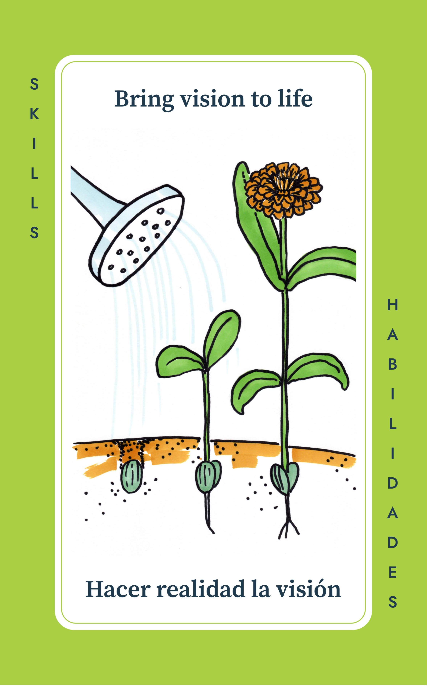{alt="Illustrated sunflower growing from a seed to a plant in three stages" style="float: left; margin-left: 15px; margin-top: 10px; margin-bottom: 20px;" width="18%" .lightbox}
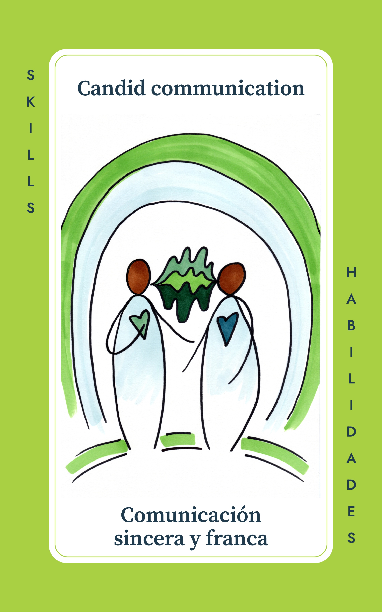{alt="Two illustrated people exchange stylized sound waves under a neutral-colored arch" style="float: left; margin-left: 15px; margin-top: 10px; margin-bottom: 20px;" width="18%" .lightbox}
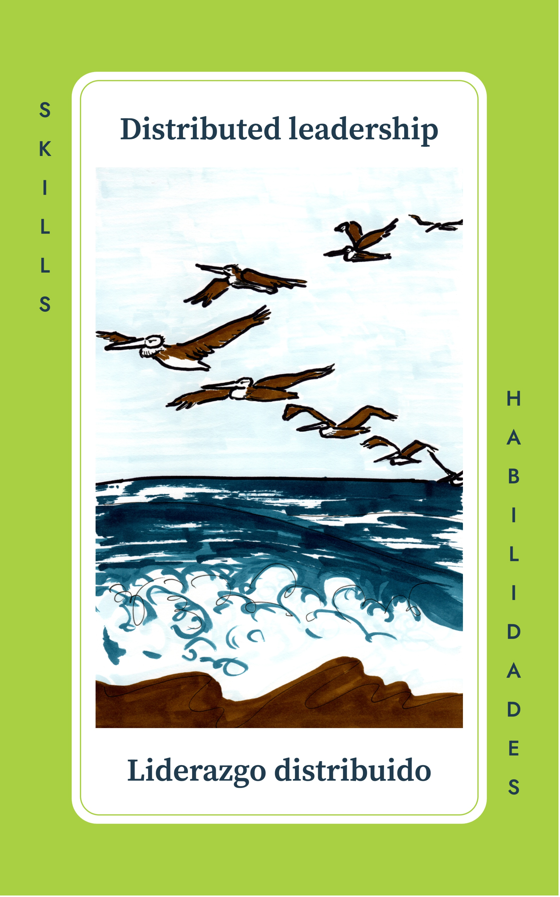{alt="Illustrated flying 'V' of migratory birds over an ocean" style="float: left; margin-left: 15px; margin-top: 10px; margin-bottom: 20px;" width="18%" .lightbox}
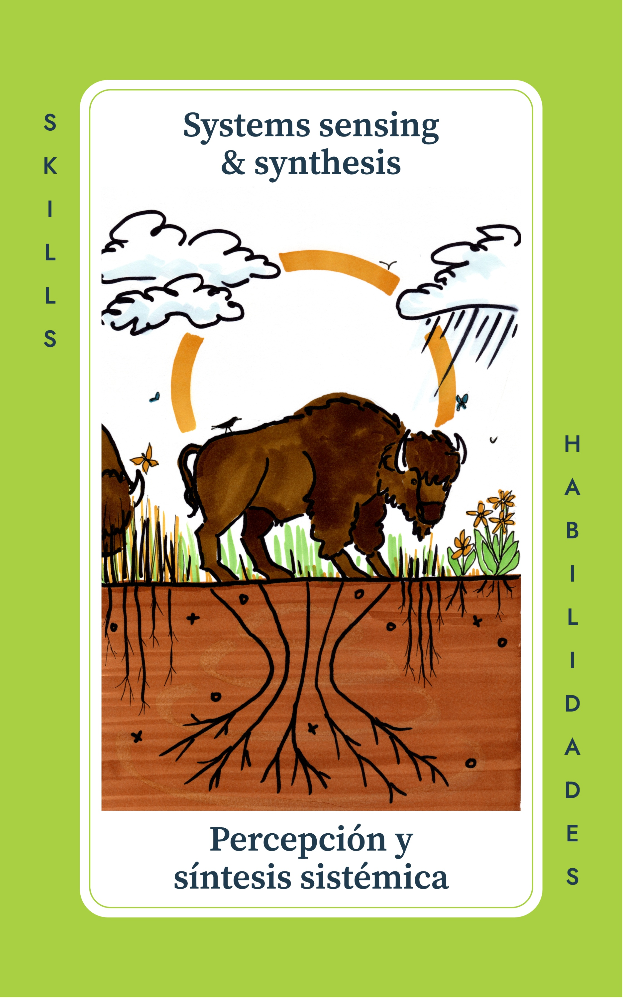{alt="Illustration of a bison surrounded by the organic and environmental components of its ecosystem" style="float: left; margin-left: 15px; margin-top: 10px; margin-bottom: 20px;" width="18%" .lightbox}
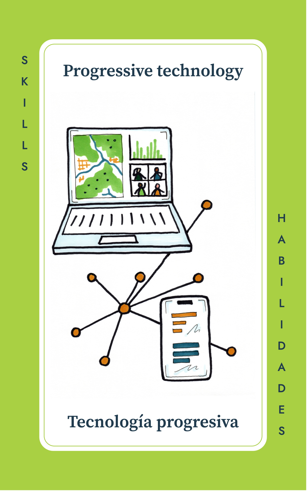{alt="Illustration of a laptop and a cell phone connected by a network of circles and lines" style="float: left; margin-left: 15px; margin-top: 10px; margin-bottom: 20px;" width="18%" .lightbox}

## [ Stewardship | Fortalecimiento]{.cc-steward}

:::{.callout-tip icon="false" collapse="true"}
###  Active listening \| Escucha activa

**Stay fully present, ask open-ended questions, listen for story and possibility, and build on others' ideas while centering voices that are often unheard.**

>  Actively listens to, demonstrates understanding and builds on the thoughts and ideas of others    Asks open ended questions, not leading questions    Embraces the silent space

:::

:::{.callout-tip icon="false" collapse="true"}
###  Move at the speed of trust \| Muévete a la velocidad de la confianza

**Build mutual respect and understanding by meeting people where they are, investing in relationships with intention and patience, and recognizing that collaborative processes are nonlinear.**

>  Is transparent and authentic about realistic process and outcomes, and follows through on commitments    Pauses when there is conflict to for mediation and to ensure resolution before continuing the work    Recognized and embraces nonlinear nature of the work including forward and backward steps

:::

:::{.callout-tip icon="false" collapse="true"}
###  Embrace complexity \| Abraza la complejidad

**Sit with uncertainty and discomfort, avoid quick fixes, and create space for thoughtful sense-making before acting.**

>  Builds comfort with the mess and avoids the quick fix    Creates opportunities for sense making before decision making

:::

:::{.callout-tip icon="false" collapse="true"}
###  Work to transform power \| Trabaja para transformar el poder

**Reflect on system dynamics, co-create ways to shift imbalances, and design spaces that share power rather than concentrate it.**

>  Creates spaces and structures that distribute power rather than concentrate it    Pauses to reflect on team and system dynamics, and personal power and influence

:::

:::{.callout-tip icon="false" collapse="true"}
###  Build capacity in others \| Potencia las habilidades de otros

**Share knowledge openly, co-create goals and agreements, and mentor and support others to strengthen collective leadership.**

>  Shares knowledge, resources, and lessons learned to build capacity in others    Practices transparency and non-attachment when sharing with collaborators    Provides coaching, mentoring, or constructive feedback that supports the development new skills and greater confidence

:::

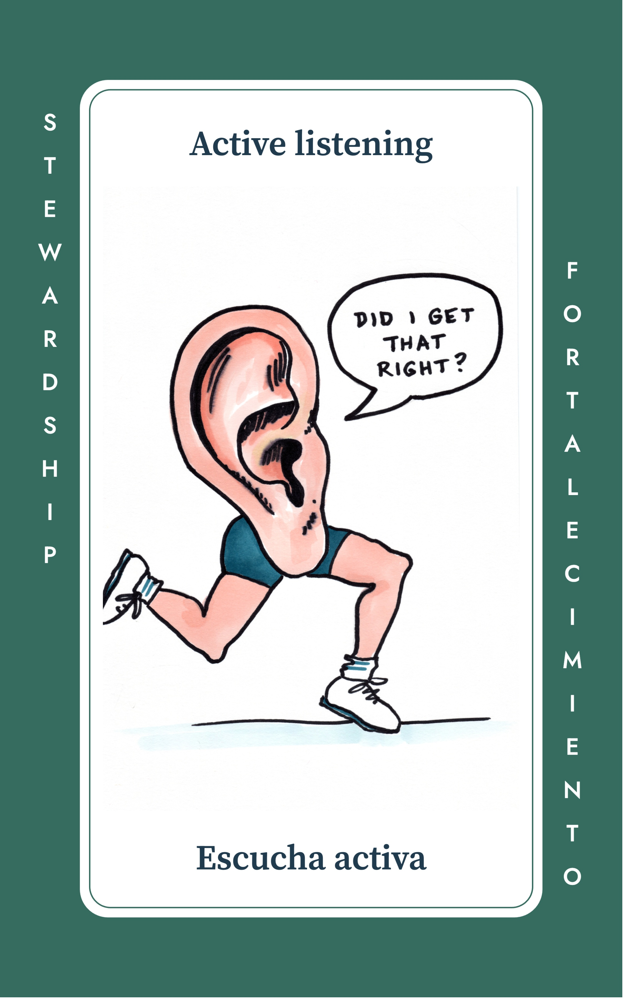{alt="Illustration of an ear with human legs running" style="float: left; margin-left: 15px; margin-top: 10px; margin-bottom: 20px;" width="18%" .lightbox}
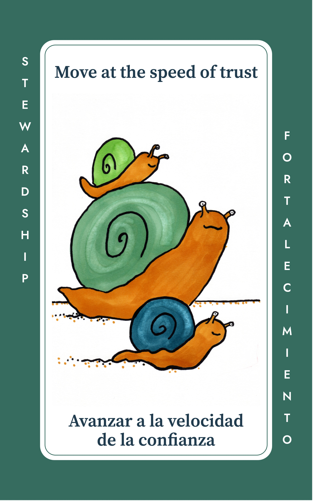{alt="Illustration of a group of snails moving together" style="float: left; margin-left: 15px; margin-top: 10px; margin-bottom: 20px;" width="18%" .lightbox}
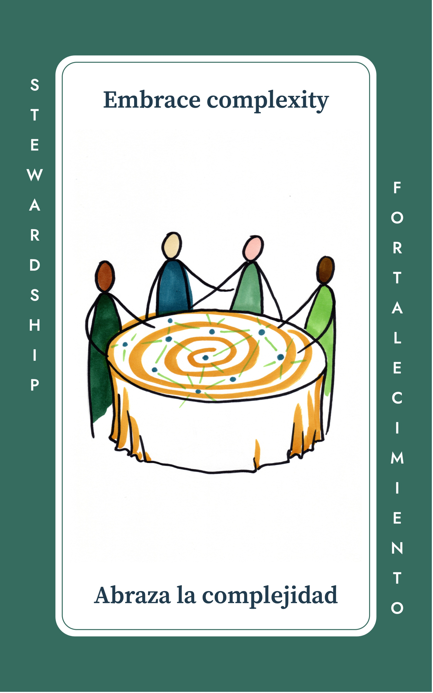{alt="Illustration of a group of people surrounding a table with a complex, swirling pattern on it" style="float: left; margin-left: 15px; margin-top: 10px; margin-bottom: 20px;" width="18%" .lightbox}
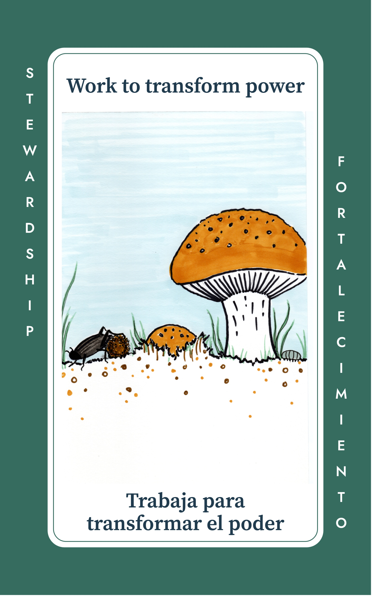{alt="Illustration of a large mushroom overshadowing a small dung beetle rolling a ball" style="float: left; margin-left: 15px; margin-top: 10px; margin-bottom: 20px;" width="18%" .lightbox}
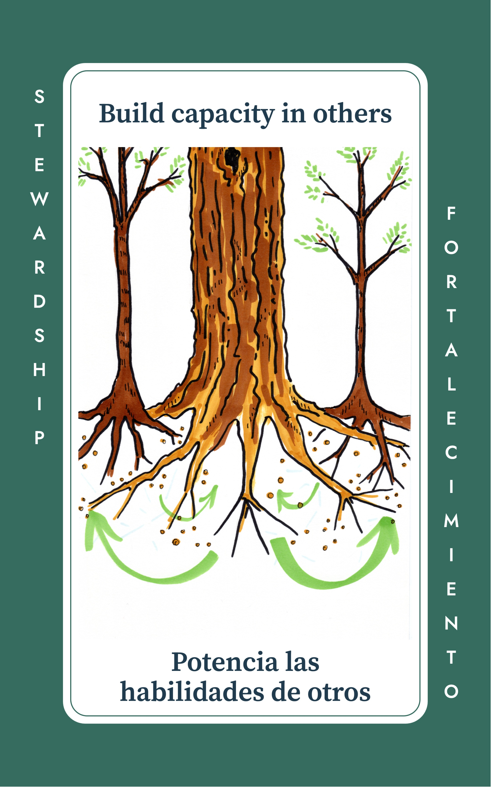{alt="Illustration of a large tree's roots with arrows pointing to the roots of smaller, nearby trees" style="float: left; margin-left: 15px; margin-top: 10px; margin-bottom: 20px;" width="18%" .lightbox}

## [ Results | Resultados]{.cc-result}

:::{.callout-caution icon="false" collapse="true"}
###  Deliver high quality results \| Entrega resultados de alta calidad

**Produce work that meets high standards and take accountability when outcomes fall short.**

>  Content, deliverables and design are high quality    Completes tasks accurately and on time, ensuring records, documentation, and processes are organized, accessible, and support smooth organizational operations    Takes accountability where results fall short    Collective priorities are translated into clear milestones, and measurable progress toward long-term goals is consistently demonstrated

:::

:::{.callout-caution icon="false" collapse="true"}
###  Drive cycles of continuous improvement and evolution \| Impulsa ciclos de mejora continua y evolución

**Release what's done, stay curious about what's next, and iterate openly with team to keep evolving.**

>  Demonstrates ability to let go and liberate what comes next    Maintains open communication and reflection with team

:::

:::{.callout-caution icon="false" collapse="true"}
###  Share the story \| Comparte la historia

**Celebrate successes, share key learnings, and capture work in ways that inspire learning, replication, and broader impact.**

>  Celebrates the successes    Stories and lived experiences are shared in ways that deepen engagement with people, place, mission, and purpose    Creative approaches are used to make knowledge, lessons, and complex ideas memorable and accessible    Stories preserve and transmit history, lived experience, ecological memory, and cultural identity across communities and generations    Builds models and documents work for wide-spread recycling, learning and use

:::

:::{.callout-caution icon="false" collapse="true"}
###  Achieve progress towards goals, mission and vision \| Logra avances hacia las metas, misión y visión

**Achieves large-scale goals that integrate a collective of diverse interests over time.**

>  Collective priorities are translated into clear milestones, and measurable progress toward long-term goals is consistently demonstrated

:::

:::{.callout-caution icon="false" collapse="true"}
###  Ensure belonging, access and opportunity \| Garantiza pertenencia, acceso y oportunidad

**Ensure an experience of belonging, access and opportunity externally and internally.**

>  Shares credit and recognition broadly, ensuring contributions are visible across all levels and identities    Team members and partners consistently report feeling valued, included, and able to contribute fully    Barriers to participation (structural, cultural, or logistical) are reduced or eliminated, resulting in broader and more diverse engagement

:::

:::{.callout-caution icon="false" collapse="true"}
###  Cultivate leadership \| Cultivar el liderazgo

**The collective strengths of the team are give space to shine and opportunities for growth are offered resulting in stronger leadership.**

>  Team members' skills, expertise, and perspectives are utilized in ways that improve the quality, efficiency, and impact of team outcomes    Team members gain new skills, confidence, responsibilities, or leadership opportunities as a result of coaching, feedback and knowledge sharing    The team demonstrates increased trust, shared ownership, and effectiveness in achieving goals, solving problems, and delivering results together

:::

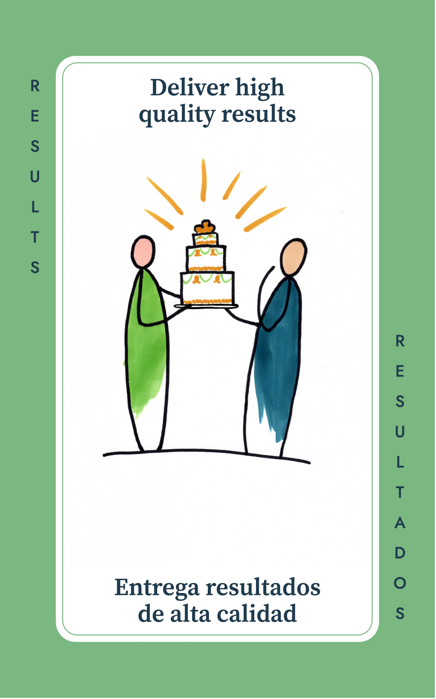{alt="Illustration of one person handing a multi-tiered cake to another" style="float: left; margin-left: 15px; margin-top: 10px; margin-bottom: 20px;" width="18%" .lightbox}
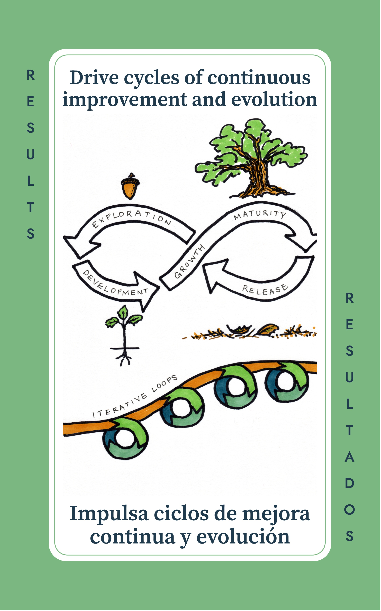{alt="Illustration of an infinity symbol connecting an acorn to a sapling to an oak tree and back again" style="float: left; margin-left: 15px; margin-top: 10px; margin-bottom: 20px;" width="18%" .lightbox}
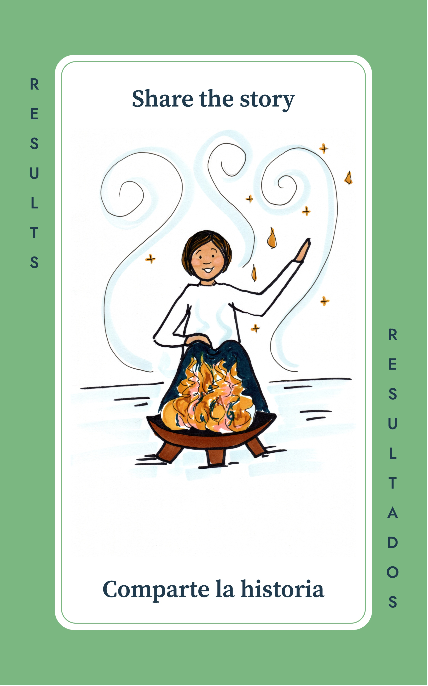{alt="Illustration of a person gesticulating over a campfire while sparks rise" style="float: left; margin-left: 15px; margin-top: 10px; margin-bottom: 20px;" width="18%" .lightbox}
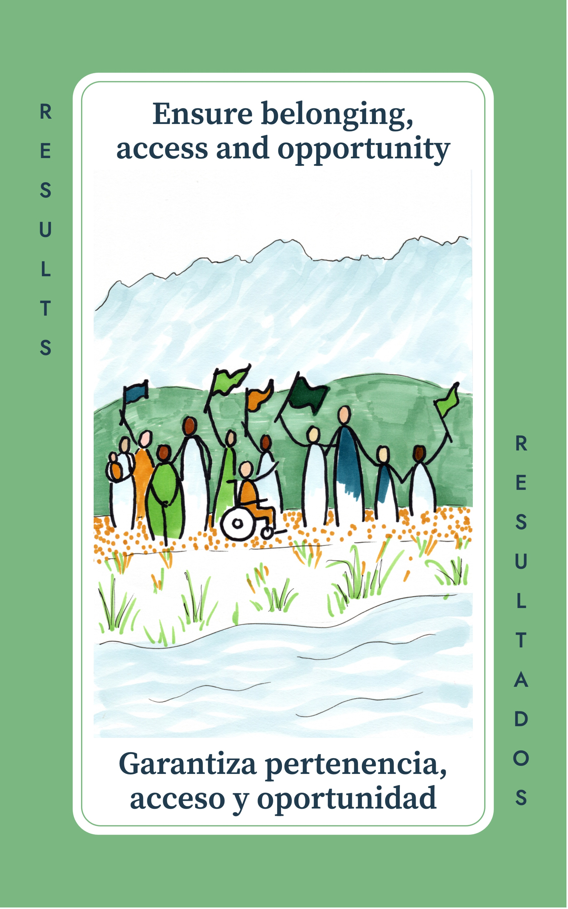{alt="Illustration of a group of people waving flags together on a riverbank" style="float: left; margin-left: 15px; margin-top: 10px; margin-bottom: 20px;" width="18%" .lightbox}
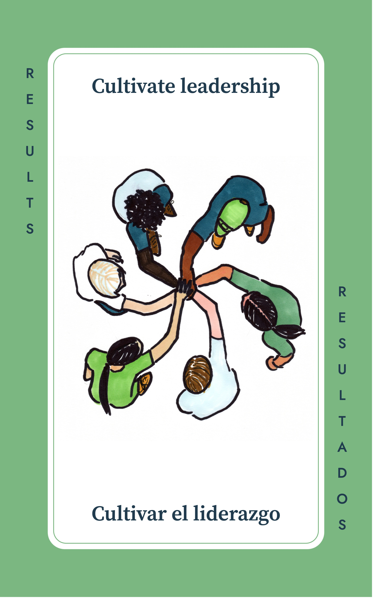{alt="Illustration looking down on a group of people standing in circle holding their hands into the center" style="float: left; margin-left: 15px; margin-top: 10px; margin-bottom: 20px;" width="18%" .lightbox}
